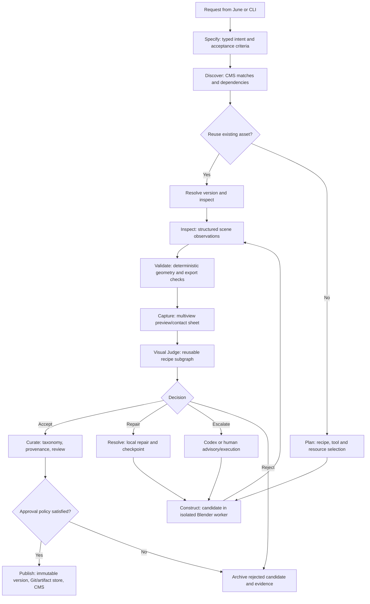
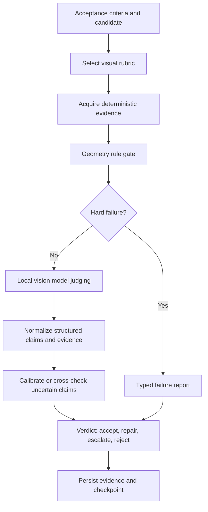

# Agentic Blender Foundry: MechaHarness Execution Architecture

Status: Architectural inspiration / proposed interfaces, not implemented
Date: 2026-10-21
Companion: [Blender tools and repositories](blender-tools-and-repositories.md)
Branch: docs/blender-tool-inspiration-catalog

## Scope and source verification

This document sketches a June-orchestrated, MechaHarness-driven 3D asset and scene foundry with local-first inference, typed Blender operations, reusable visual-judging recipes, and curated publishing.

**Folk visual judging source status: NOT VERIFIED.** A search for `rl337/folk` and GitHub code searches for `visual judge`, `visual judging`, `recipe`, and `screenshot` in that repository did not locate the requested code. Do not interpret the following proposed visual judging contracts as descriptions of existing Folk implementation. Before implementing, locate the correct Folk repository/ref and inspect its actual recipes, prompts, grading data types, thresholds, retry behavior, screenshots, and tests. Integrate existing recipe semantics rather than duplicating them.

## Design boundaries

- **June**: optional supervisor and remote API; scheduling, job persistence, budgets, approvals, resource placement and model loading. A Blender job must also be runnable locally without June.
- **MechaHarness**: graph recipes, hard/soft nodes, dependency injection, checkpoint/recovery, typed judging, repair, human intervention, Codex escalation and tool policy.
- **rl337/blender**: Blender-specific tools, worker protocol, asset manifests, geometry validators, preview generation, recipes and curated artifacts.
- **Folk CMS library**: asset identities, taxonomy, versions, provenance, indexing, cross-project discovery and publication contracts. Inspect before adopting a new registry.
- **NeoStudio / Folk**: downstream creative goals, asset/scene/shot specifications, approval policy.
- **home_network**: Pi 5 8GB ARM64 headless workers and deploy manifests; JuneSpark local inference; Mac as optional heavy render worker.

## Conceptual graph



The diagram is conceptual. A failed deterministic validation can bypass expensive visual judging and route to repair/reject. Accepted reused assets need not be republished. Scene composition can recursively invoke asset resolution. No repair or escalation can bypass the original acceptance checks.

## Hard nodes and injectable soft capabilities

| Hard node | Required input/output | Soft injectables | Owner |
| --- | --- | --- | --- |
| Specify | `ProductionRequest -> AssetSpec + AcceptanceSpec` | intent interpreter, constraint extractor | MechaHarness recipe + Blender schema |
| Discover | `AssetSpec -> CandidateMatches` | CMS search, dependency/version resolver | CMS adapter |
| Plan | `AssetSpec + Matches -> BuildPlan` | recipe selector, worker/model planner | Blender + June policy |
| Construct | `BuildPlan -> CandidateArtifactRef` | typed bpy executor, parametric generators, optional neural 3D | Blender worker |
| Inspect | `CandidateArtifactRef -> SceneObservation` | object/collection/rig/material inventory, bounds | Blender worker |
| Validate | `SceneObservation -> RuleResults` | topology, manifold, dimensions, UV, naming, export tests | Blender worker |
| Capture | `CandidateArtifactRef -> ViewSet` | camera presets, turntable, contact sheet, scene passes | Blender worker |
| VisualJudge | `AcceptanceSpec + ViewSet + RuleResults -> JudgeVerdict` | Folk recipe adapter (pending source), VLM, comparison rubric, panels | MechaHarness |
| Resolve | `JudgeVerdict + AttemptHistory -> ResolutionPlan` | local repair, Codex, human | MechaHarness |
| Curate | `AcceptedCandidate -> CuratedManifest` | taxonomy classifier, provenance validator, human reviewer | Blender + CMS |
| Publish | `CuratedManifest -> AssetVersionRef` | Git/LFS, object store, CMS registry | Blender + CMS |

## Visual judging recipe subgraph (proposed, Folk source pending)



Suggested judge output (not verified against Folk):

```json
{
  "candidate_id": "candidate-uuid",
  "rubric_version": "visual-rubric-v1",
  "decision": "repair",
  "requirements": [
    {"id": "silhouette", "status": "fail", "evidence": ["view-front.png"], "reason": "reference mismatch"}
  ],
  "uncertainties": [],
  "recommended_repairs": ["adjust proportions"],
  "attempt": 1
}
```

Principles:
1. Distinguish **objective** geometry/export checks from **subjective** aesthetic/semantic judgments.
2. Use multi-view images, consistent camera presets and explicit evidence references. Include wireframe, normals/depth or UV views when useful.
3. Bind a judge to a versioned rubric and explicit acceptance criteria; never let the generator define success after the fact.
4. Avoid self-preference, position and verbosity bias; optionally use independent judge panels or disagreement checks for ambiguous cases.
5. Local-first VLM; escalate only for low-confidence or repeatedly unresolved cases.
6. Repair budget, no-progress detection and repeated-state detection are mandatory; preserve previous failures.
7. After repair, re-run the original validators and judges. Persist judge inputs, outputs, model identity and evidence.
8. Human and test-suite drivers must be able to supply the same verdict contract.

**Folk integration TODO**: inspect the actual recipes and map their node structure, camera/screenshot capture, grading prompts, acceptance thresholds, failure feedback, human approval and tests onto this subgraph. Prefer an adapter or extraction into MechaHarness over a fork.

## Runtime semantics

- Checkpoint graph state and Blender artifact refs at stable boundaries; checkpoint only after outstanding conflicts are resolved.
- Each Blender execution uses an isolated work directory, process timeout and memory/resource limits. Avoid arbitrary bpy scripts as the default API; gate them as privileged tools.
- Worker advertises Blender version, CPU architecture, memory, capabilities and render engine.
- Use deterministic event IDs, content hashes, stable artifact IDs and idempotency keys for external jobs.
- Reconcile uncertain billable jobs before retrying; explicit quote and approval policy.
- Escalation transfers a focused problem package (spec, attempted operations, traceback, views, acceptance criteria), not ownership of the workflow.
- Support both advisory and authorized sandboxed execution escalation to Codex. Subscription-backed inference requires a supported integration; arbitrary OAuth app registration is not equivalent to ChatGPT inference access.
- Local model scheduling should batch generation and judging to reduce JuneSpark model swaps.
- Graph can be driven by June, CLI, tests or a human TUI.

## Asset/scene contracts

Asset: stable ID, kind, primary taxonomy, independent facets, version, licence, provenance, source recipe, inputs, dependencies, Blender version, geometry stats, accepted views, rubric version, judge results, artifact checksums and storage URIs.

Scene: stable ID, versioned asset references, placement/transforms, cameras, lights, environment, timeline, render settings, acceptance criteria and composition recipe.

Candidate artifacts are never silently promoted into the curated library. Publishing requires deterministic validation, sufficient visual evidence and the configured approval policy. Keep physical storage replaceable (Git, LFS, MinIO).

## External attribution matrix

| Node/concern | Reference | Reuse category | Investigation |
| --- | --- | --- | --- |
| Specify / scene recipes | Scenario film JSON, Remotion | Concepts / schema patterns | Compare shot declarativity and reproducibility |
| Discover / Curate | Poly Haven, Sketchfab, MakeHuman | Taxonomy, previews, provenance | No bulk copying without licence review |
| Plan / scene context | Loopcut | Concepts | Verify in-Blender source |
| Construct / worker | Scenario Blender plugin, Blender MCP | Concrete code patterns where licensed | Main-thread dispatch, typed tools, process isolation |
| Construct / neural generation | TRELLIS, TripoSR, Stable Fast 3D, Hunyuan3D | Optional model/code adapters | Local GPU/RAM and licences |
| Capture | Scenario capture_views | Implementation pattern | Contact sheets, multiple camera viewpoints |
| VisualJudge | Folk visual recipes (unverified), Loopcut | **Existing internal recipe to inspect**, conceptual feedback loop | Locate Folk source and compare contracts |
| Resolve | Loopcut, Codex | Concepts / supported SDK integration | Failed-operation packaging, escalation policy |
| Checkpoint | Loopcut, MechaHarness existing resume design | Concept / existing primitive | Coordinate scene snapshots and graph recovery |
| External jobs | Scenario | Concrete implementation patterns | Idempotency, cost approval, uncertain job reconciliation |
| Reference imagery | ComfyUI | Optional local inference workflow | Image/depth/normal conditioning |
| Publish | Folk CMS library | Reuse existing internal API | Inspect actual implementation before design lock |

Source catalog: [blender-tools-and-repositories.md](blender-tools-and-repositories.md). Licences and source compatibility must be checked before copying implementation.

## Minimal proof of concept

1. One Pi 5 8GB runs an ARM64 Blender background smoke test; compare equivalent result on Mac.
2. Produce a procedural prop with a versioned typed spec and deterministic generator.
3. Capture a consistent six-view contact sheet, geometry metrics and one intentionally failing requirement.
4. Evaluate locally through a visual-judging recipe, produce structured failure evidence and bounded repair.
5. Verify repaired result using the **same** acceptance criteria, then publish manifest, source, previews and test results.
6. Retrieve the asset through the CMS adapter and compose it into a new scene.
7. Run the same graph from CLI/tests and June; interrupt/restart at several checkpoints.
8. Only then enable Codex escalation and optional neural 3D generators.

## Open questions / TODO

- [ ] Locate Folk repository and **read concrete visual-judging recipes**; revise this document with exact file paths, APIs and node mapping.
- [ ] Inspect current MechaHarness and June primitives before implementing overlapping nodes or persistence.
- [ ] Inspect current Blender repo assets and preserve paths and licences.
- [ ] Inspect Folk CMS data model and reuse it where possible.
- [ ] Confirm ARM64 Blender distribution on Debian Bookworm and benchmark Pi memory.
- [ ] Determine taxonomy and stable manifest schema versioning.
- [ ] Choose candidate storage versus curated Git/LFS/MinIO publication rules.
- [ ] Establish objective and subjective judge acceptance thresholds from empirical tests.
- [ ] Review upstream licence boundaries before copying code.
